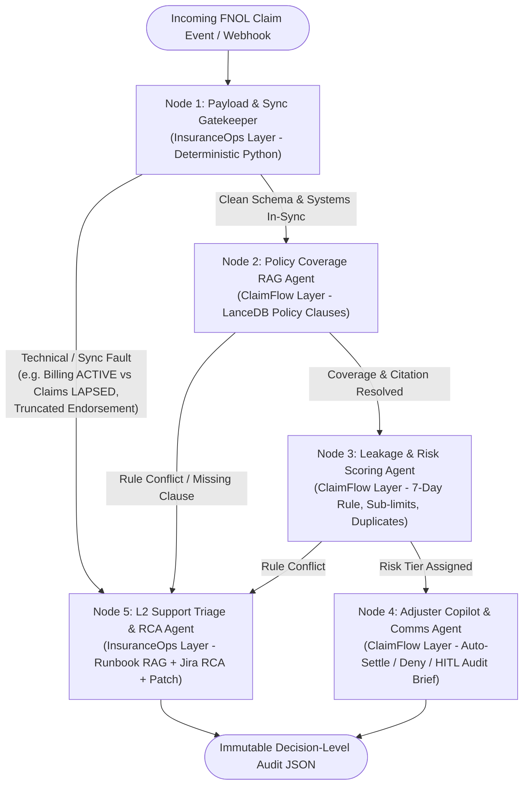

# InsureOps-ClaimFlow

**Unified P&C Claims Processing (`ClaimFlow AI`) & Core AMS L2 Support Triage (`InsuranceOps`) in a Single 5-Node LangGraph Pipeline.**

Built around ValueMomentum's two-pronged P&C delivery model—pairing AI across **business streams** (coverage analysis, claims leakage prevention, adjuster copilot) with **Core Application Managed Services (AMS)** (preventing and auto-triaging Guidewire PolicyCenter / BillingCenter / ClaimCenter integration and payload faults).

---

## Architecture: 5-Node LangGraph State Machine



---

## 3-Command Quickstart

```bash
python -m venv .venv && .\.venv\Scripts\activate
pip install -r requirements.txt
uvicorn app.main:app --reload
```

Open **[http://127.0.0.1:8000](http://127.0.0.1:8000)** to launch the single-page trace viewer with all 5 pre-loaded scenarios.

> **LLM Configuration:** Copy `.env.example` to `.env` and set `GROQ_API_KEY` for fast 2–3s hosted inference via `llama-3.3-70b-versatile` (with optional local Ollama fallback via `USE_OLLAMA_FALLBACK=true`). Without an API key, the pipeline runs in grounded `deterministic_fallback` mode using live **LanceDB** vector retrieval so evaluators can test every path immediately.

---

## 5 Pre-Loaded Demo Scenarios (`sample_data/test_events.json`)

| # | Scenario | Active Graph Path | Outcome |
|---|---|---|---|
| 1 | **Standard Auto Glass Claim** (`CLM-2026-1001`) | `Node 1 → Node 2 → Node 3 → Node 4` | `AUTO_APPROVED` ($1,200 - $250 deductible = **$950.00** net payout) |
| 2 | **Flood Damage Under Basic Fire Policy** (`CLM-2026-1002`) | `Node 1 → Node 2 → Node 3 → Node 4` | `DENIED_EXCLUDED` citing **`EX-FLD-09`** |
| 3 | **High-Value Theft 48h Post-Inception** (`CLM-2026-1003`) | `Node 1 → Node 2 → Node 3 → Node 4` | `ESCALATED_HITL` (`HIGH` risk via **`COND-7D-01`** + 84% sub-limit) |
| 4 | **Policy Status Mismatch (`ACTIVE` vs `LAPSED`)** (`CLM-2026-1004`) | `Node 1 → Node 5` | `L2_SUPPORT_TRIAGED` (`ERR_POLICY_SYNC_MISMATCH` + **`SQL_SYNC_PATCH`**) |
| 5 | **Truncated Endorsement Code (`END-GL`)** (`CLM-2026-1005`) | `Node 1 → Node 5` | `L2_SUPPORT_TRIAGED` (`ERR_MISSING_ENDORSEMENT` + **`JSON_SCHEMA_PATCH`**) |

---

## Sample Output (Scenario 4 — L2 Support Short-Circuit)

```json
{
  "claim_id": "CLM-2026-1004",
  "policy_id": "POL-CA-7731",
  "active_path": ["Node 1: Gatekeeper", "Node 5: L2 Support RCA"],
  "final_outcome": "L2_SUPPORT_TRIAGED",
  "gatekeeper": {
    "passed": false,
    "route": "l2_support",
    "error_code": "ERR_POLICY_SYNC_MISMATCH",
    "billing_status": "ACTIVE",
    "claims_status": "LAPSED"
  },
  "l2_support_ticket": {
    "assigned_queue": "AMS-Core-Integration-L2",
    "severity": "P1",
    "matched_runbook_sop": "ams_support_runbook.md :: SOP-AMS-001",
    "patch_type": "SQL_SYNC_PATCH",
    "proposed_patch": "UPDATE cc_policy_cache\nSET status = 'ACTIVE', sync_source = 'PolicyCenter_Reconciled', updated_at = CURRENT_TIMESTAMP\nWHERE policy_id = 'POL-CA-7731' AND billing_status = 'ACTIVE';"
  }
}
```

---

## Repository Structure

```text
insureops-claimflow/
├── app/
│   ├── main.py              # FastAPI endpoints (/, /health, /scenarios, /process-claim, /audit-logs)
│   ├── schemas.py           # Pydantic v2 domain models & LangGraph WorkflowState
│   ├── graph.py             # 5-node LangGraph StateGraph & conditional edges
│   ├── nodes/
│   │   ├── gatekeeper.py    # Node 1: Payload schema & PolicyCenter/Billing/Claims sync guardrail
│   │   ├── policy_rag.py    # Node 2: LanceDB retrieval over synthetic P&C policy wordings
│   │   ├── risk_scorer.py   # Node 3: Deterministic 7-day inception, sub-limit, & duplicate rules
│   │   ├── adjuster.py      # Node 4: Itemized payout math, SmartCOMM notice, & HITL brief
│   │   └── l2_support.py    # Node 5: AMS runbook RAG + Jira RCA + SQL/JSON patch proposal
│   └── tools/
│       ├── llm_client.py    # Groq structured output + optional Ollama & deterministic fallback
│       ├── policy_registry.py # Mock Guidewire PolicyCenter / BillingCenter / ClaimCenter state
│       └── rag_store.py     # Embedded LanceDB indexing & hybrid vector+keyword retrieval
├── sample_data/
│   ├── commercial_auto_policy.md
│   ├── ams_support_runbook.md
│   └── test_events.json
├── static/
│   └── index.html           # Single-page visual trace viewer
├── tests/
│   └── test_workflow.py     # End-to-end pytest suite for all 5 scenarios
├── .env.example
└── requirements.txt
```

## Running Tests

```bash
pytest -v
```
